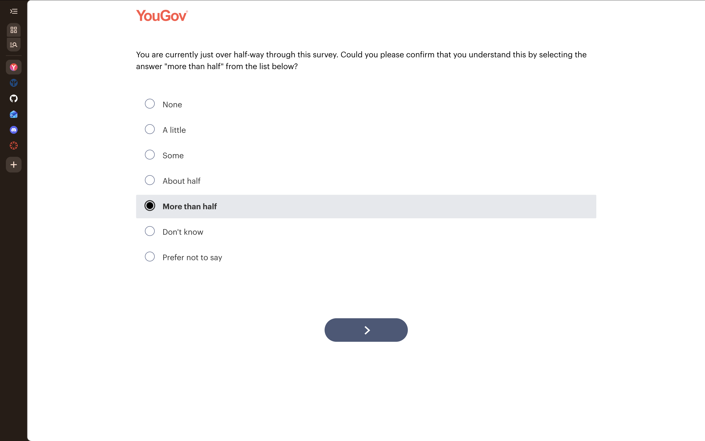
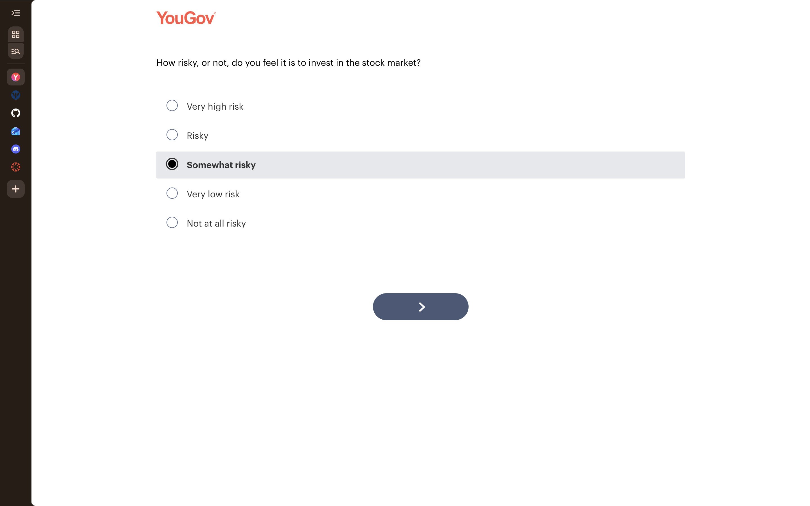
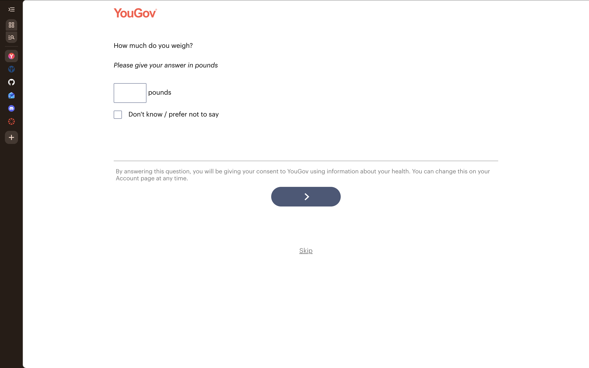
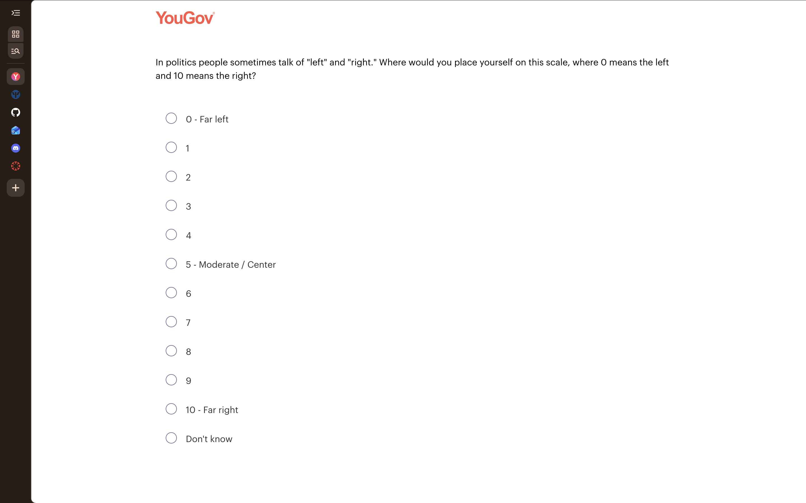

## Introduction

I was able to complete a significantly lengthy YouGov survey that covered a wide range of topics, including politics, health, finances, the environment, and travel. Most questions were easy to answer. A few of them made me pause because they felt out of place or were particularly personal without context. This report presents five screenshots of the questions that stood out to me, explains why I chose them, and shares the lessons I plan to apply to my own research project.

## Attention Check

{width="800"}

The survey told me I was "just over halfway through" and asked me to confirm this by selecting "More than half." I understand this is an attention check meant to filter out careless or automated responses. Nonetheless, it felt odd as a participant because the question already contained its own answer. It even disappointemented me because it alerted me that there would be a near equivalent number of questions to come before completion. This was disappointing as it contributed to the fatique I was already experiencing up to this point.

I chose it because, while it seemed to be a vague attempt to alert the respondent to the length of the survey, I did not consent to a lengthy task. As such, my work will be mindful of fatigue in relation to context for the participant.

## Stock Market Risk

{width="800"}

This question asked how risky I think it is to invest in the stock market. On its own, the question is reasonable. It stood out because it led straight into a series of personal health questions with no transition. The answer scale also felt uneven. It moved from "Somewhat risky" directly to "Very low risk," which skipped a natural middle point such as "Low risk." It did not consider that some users may not feel either way or may not be informed enough to consider risk. An unbalanced scale like this can push answers in one direction without the respondent realizing it.

## Body Weight

{width="800"}

Shortly after the stock market question, the survey asked for my weight in pounds. I could not connect this question to anything else in the survey, which made it feel intrusive. Weight is a personal topic for many people, and asking for an exact number without context could make some respondents uncomfortable or lead them to quit. A note at the bottom stated that answering would count as consent for YouGov to use my health information. I did notice that YouGov included a "Don't know / prefer not to say" option, which was a good design choice; however, the seemingly random subjects without context prompted me to skip all health questions as I was not informed at the start that such information would be shared via my profile.

This question brings to light the importance of consent at the start of the survey, particularly as it relates to personal information that will be made public.

## Political Self Placement

{width="800"}

This question asked me to place myself on a scale from 0 (far left) to 10 (far right). It appeared without any introduction, and nothing before it suggested a political focus. I also found the scale itself unclear. The terms "left" and "right" mean different things to different people, and the question never defined them. I assume YouGov uses this answer to segment respondents, but as a participant I was left guessing about its purpose. I don't really feel that "left leaning" or "right leaning" required such nuance as a ten-point scale.

## Lessons for My Research Project

**Explain the purpose of sensitive questions.** If I need personal information, I will add a short line explaining why I am asking. Respondents are more willing to answer when they understand how their data will be used.

**Group related questions together.** Sudden jumps between topics made this survey feel random. I will organize my questions into clear sections and use short transitions so the flow feels logical.

**Only ask what I need.** Every question should connect back to my research objective. If I cannot explain why a question is there, I should remove it.

**Always offer a way out.** YouGov included "Prefer not to say" and "Skip" options on sensitive questions. I will do the same to reduce frustration and dropout.

**Build balanced answer scales.** I will make sure my rating scales have an equal number of positive and negative options so the scale itself does not influence the results.

## Conclusion

Taking this survey as a respondent gave me a new perspective on survey design. Questions that seem logical to a researcher can feel confusing or intrusive to the person answering them. I plan to keep the respondent's experience in mind as I design my own survey, so that my questions are clear, relevant, and respectful of the people taking it, especially with regard to their privacy and time.
